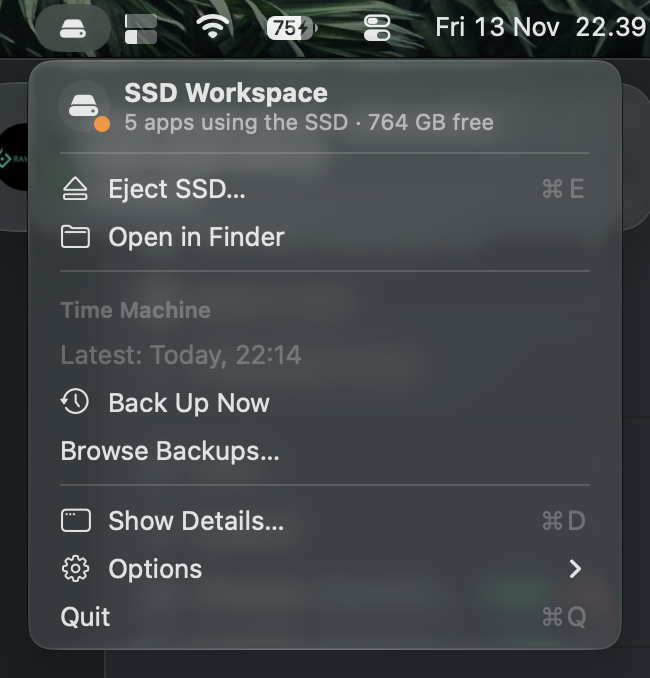
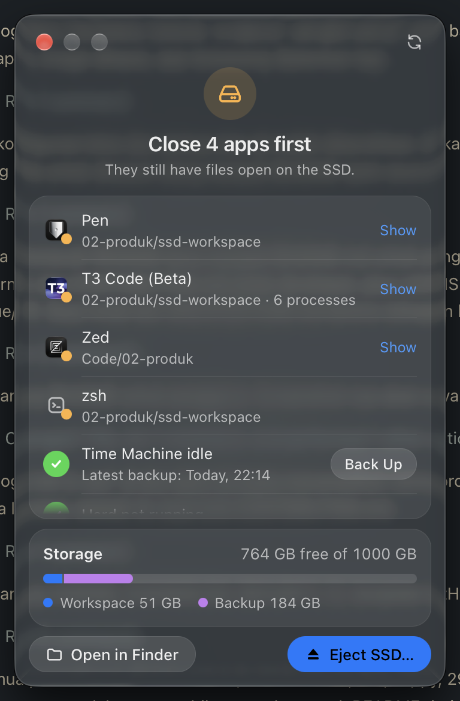

# SSD Workspace

A macOS menu bar app for people who work from an external SSD. It shows whether the SSD is
safe to unplug, tells you which apps are still using it, and ejects it safely: it stops Time
Machine and Laravel Herd for you when they are running, and never force-quits anything.

It also replaces the built-in Time Machine menu, so you can hide that icon and keep the menu
bar tidy.

<p align="center">
  
  &nbsp;
  
</p>

## Features

- **A glance is enough.** The menu header says "Ready to eject" or "2 apps using the SSD",
  with the free space. The menu bar icon changes while a backup runs or the SSD ejects.
- **Knows who is holding the SSD.** Processes are grouped by app, so you see "Terminal" and
  "Zed" instead of `bash`, `node` and PIDs, along with the folder each app is working in.
  **Show** brings an app to the front so you can close it yourself.
- **Safe eject.** Always asks first. Stops a running Time Machine backup and running Herd
  services, then ejects the whole disk. If something still holds the SSD, it tells you what
  and lets you try again. User processes are never killed.
- **Time Machine menu.** Latest backup, Back Up Now, live progress with Skip This Backup,
  Browse Backups and Time Machine Settings, in the same menu.
- **Native and light.** Liquid Glass Detail window, SF Symbols in the menu, light and dark
  mode. It wakes up only when a volume is mounted or unmounted and checks Time Machine every
  30 seconds, so it costs next to nothing while idle.

## Requirements

- macOS 14 or later (designed for macOS 26 and 27; the Liquid Glass window falls back to a
  vibrancy blur on older versions).
- An external disk whose main volume you work from. A second volume on the same disk for Time
  Machine is optional.
- [Laravel Herd](https://herd.laravel.com) is optional; it is only touched if it is running.

## Install

There are no prebuilt releases yet, so build the app from source. You need
[Rust](https://rustup.rs), [Node.js](https://nodejs.org) with [pnpm](https://pnpm.io), and the
Xcode Command Line Tools (`xcode-select --install`).

```sh
git clone https://github.com/rizkirmdhnnn/ssd-workspace.git
cd ssd-workspace
pnpm install
pnpm tauri build --bundles app
cp -R "src-tauri/target/release/bundle/macos/SSD Workspace.app" ~/Applications/
open ~/Applications/"SSD Workspace.app"
```

Build and install from a folder that is **not** on the SSD you want to manage, or at least
run the copy in `~/Applications`, not the one in `target/`. An app can't eject the disk it
is running from.

The app is ad-hoc signed. It runs fine on the Mac that built it; to copy it to another Mac,
build it there or sign it with your own Developer ID.

To start it at login, choose **Options → Open at Login** in its menu. This adds a LaunchAgent
(`~/Library/LaunchAgents/SSD Workspace.plist`).

## Configuration

By default the app manages a volume named **Workspace** (`/Volumes/Workspace`) and a backup
volume named **Backup** (`/Volumes/Backup`) on the same disk. To use other names, create
`~/Library/Application Support/com.rizkirmdhn.ssdworkspace/config.json`:

```json
{
  "workspaceVolume": "Projects",
  "backupVolume": null
}
```

| Key | Default | Meaning |
| --- | --- | --- |
| `workspaceVolume` | `"Workspace"` | The volume you work on. Ejecting it ejects the whole disk. |
| `backupVolume` | `"Backup"` | Another volume on the same disk, usually your Time Machine destination. `null` if there is none. |

Names are volume names as they appear in `/Volumes`, not paths. Restart the app after
changing the file. If the file is invalid, the app logs a message and uses the defaults.

### Hiding the built-in Time Machine icon

The Time Machine section of the menu mirrors the system's Time Machine menu, so you can hide
that icon: **System Settings → Control Center → Time Machine → Don't Show in Menu Bar**.

## Using it

- **The menu** (click the drive icon): the header shows whether the SSD is ready to eject.
  Clicking the header opens the Detail window. **Eject SSD…** (⌘E) starts the eject, and
  **Options** has Refresh Status, Open at Login and Time Machine Settings.
- **The Detail window** (**Show Details…**, ⌘D): a checklist of everything between you and
  unplugging. That includes every app still using the SSD, Time Machine and Herd. A storage
  bar below shows how the disk's space is split between the volumes.
- **Ejecting.** Confirm the dialog; the app stops what needs stopping, ejects, and tells you
  when it is safe to unplug. If an app still holds the SSD, close it (or click **Show** in
  the Detail window) and choose **Try Again**.

## Privacy and permissions

- No network access, no analytics, nothing leaves your Mac.
- No special permissions. The latest backup date is read from the Time Machine preferences,
  so Full Disk Access is not needed.
- Commands it runs, always by absolute path and without a shell: `lsof`, `tmutil`,
  `defaults`, `diskutil`, `open`, and Herd's own `herd` CLI.

## Troubleshooting

- **"SSD is still in use" keeps coming back.** An app has a file or its working folder on
  the SSD. Terminal tabs whose current folder is on the SSD count. The dialog lists the
  processes, and the Detail window groups them by app with the folder each one is using.
  Close them or `cd` elsewhere, then try again.
- **The menu says "Not mounted" but the disk is plugged in.** Check the volume names in
  `/Volumes` and set them in [`config.json`](#configuration).
- **Something seems off.** Run the app from a terminal with `SSD_WORKSPACE_TRACE=1` to log
  every status refresh and the commands it runs:
  `SSD_WORKSPACE_TRACE=1 ~/Applications/"SSD Workspace.app"/Contents/MacOS/ssd-workspace`.

## Contributing

Contributions are welcome. See [CONTRIBUTING.md](CONTRIBUTING.md) for how to build, test
safely with dry-run mode, and submit changes, and [docs/ARCHITECTURE.md](docs/ARCHITECTURE.md)
for how the app works inside.

## License

[MIT](LICENSE)
