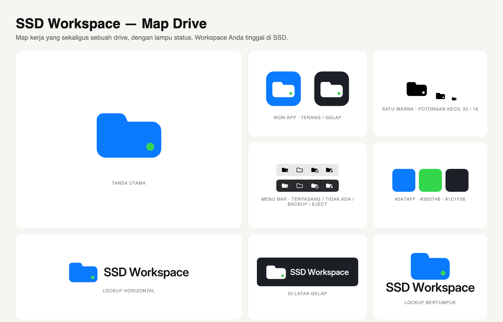

# SSD Workspace — Panduan Logo (Map Drive)

## 1. Logo
- **Ide:** map kerja yang sekaligus sebuah drive, dengan lampu status. Workspace Anda tinggal di SSD.
- **Versi:** lockup horizontal (utama) · lockup bertumpuk · tanda saja · wordmark saja.
- **Lampu status wajib ada.** Tanpa lampu, tanda ini hanya ikon map biasa.

## 2. File
| File | Untuk |
|---|---|
| `svg/mapdrive-warna.svg` | Tanda utama berwarna (README, web) |
| `svg/mapdrive-hitam.svg`, `-putih.svg`, `-biru.svg` | Satu warna. Lampu menjadi lubang. |
| `svg/mapdrive-kecil.svg` | Potongan kecil untuk ukuran ≤ 32 px (lampu lebih besar) |
| `svg/appicon.svg`, `appicon-gelap.svg` | Ikon app macOS (grid 1024, badan 824) |
| `svg/tray-*.svg`, `png/tray-*.png` | Template icon menu bar 23×18 pt (@2x = 46×36 px) |
| `svg/lockup-*.svg`, `svg/wordmark.svg` | Lockup dan wordmark, teks sudah berupa outline |
| `tauri-icons/` | Hasil `pnpm tauri icon` untuk `src-tauri/icons` |

## 3. Ruang kosong dan ukuran minimum
- Ruang kosong di sekeliling logo = **2 × diameter lampu** pada ukuran yang dipakai.
- Tanda saja: minimal 16 px (pakai `mapdrive-kecil.svg` di bawah 32 px).
- Lockup horizontal: minimal 120 px lebar.

## 4. Warna
| Nama | HEX | Peran |
|---|---|---|
| Biru Workspace | `#0a7aff` | Badan tanda, latar ikon app (sama dengan `--accent` aplikasi) |
| Hijau Aman | `#32d74b` | Lampu status (sama dengan `--ok` mode gelap) |
| Tinta | `#1c1f26` | Latar ikon app gelap, latar gelap |

Pasangan yang disetujui: berwarna di atas putih · putih (lampu hijau) di atas biru atau tinta · hitam di atas putih.

## 5. Tipografi
Wordmark memakai **Inter SemiBold** (lisensi SIL OFL, aman untuk logo), sudah dikonversi menjadi outline.
Tracking −1,5 pada ukuran 84. Jangan mengetik ulang wordmark.

## 6. Jangan
Jangan meregangkan, memutar, atau mengganti warna di luar palet. Jangan menghapus lampu status. Jangan menambah
bayangan, gradasi, atau garis tepi. Jangan mengubah jarak antara tanda dan teks di lockup.

## 7. Catatan
- Belum ada pemeriksaan merek dagang. Bentuk map adalah bahasa umum macOS; ciri khasnya ada di lampu status.
- Ikon tray adalah template image (hitam + alfa); macOS mewarnainya sendiri untuk mode terang dan gelap.
